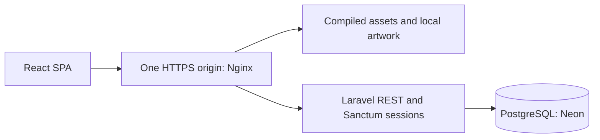

Eneba Intern Assignment 2027

Independent marketplace demo using **React, TypeScript, Vite, Tailwind CSS, Laravel REST, PostgreSQL and Sanctum**. The interface is inspired by Eneba, with locally served game covers, original promotional artwork and a clear internship identity. No real money or redeemable keys are used.

**Live demo:** [keymarket-demo.vercel.app](https://keymarket-demo.vercel.app). Vercel hosts the frontend and Laravel API together, with a Neon PostgreSQL database. [Public HTTPS verification](docs/public-verification.json).

## Submission package

[Requirements checklist](docs/submission-checklist.md) · [Architecture and interview guide](docs/architecture-explained.md) · [Project summary](docs/project-summary.md) · [Security and transcript export](docs/submission-security.md) · [Changed files](docs/submission-changed-files.json).

**GitHub repository:** [Farid1324/Project_clone](https://github.com/Farid1324/Project_clone), published on **main**. Source, artwork, tests, configuration, documentation and the available original AI prose transcript are included. [Publication verification](docs/github-publication.json) · [GitHub Actions](https://github.com/Farid1324/Project_clone/actions) · [Transcript instructions](docs/submission-security.md).

## Features and demo data

Six independently queried homepage sections; searchable/filterable/sortable store with pagination and URL state; global partial/typo autocomplete; detailed activation/requirements information; multiple independently priced/rated sellers; seller-offer carts; registration/login/logout; authenticated quote review; memory-only sample-card entry and simulated verification; successful/declined payment simulations; unique encrypted demo-key allocation and private order/key history. A persistent account wishlist saves products across reloads and logins, with shared heart controls and a header count. Loading, empty, error and responsive states are implemented. React has no hardcoded product fixtures.

### Wishlist

Sign in and select a heart on a homepage/catalog card or product detail. Visit /wishlist from the header to open a product, compare sellers or remove it. Guest heart actions return through sign-in and then save the selected product. Products stay saved when stock disappears; unpublished listings remain removable without a broken detail link. Wishlist actions use current backend data and do not reserve keys. See [wishlist implementation and verification](docs/wishlist-milestone.md).

For an existing installation, apply the additive migration and rebuild React; no reseeding or data reset is required:

```powershell
Set-Location backend
& ..\.tools\php\php.exe artisan migrate --no-interaction
Set-Location ..
.\scripts\build-single-origin.ps1
```

### Demo card checkout

Choose a sample card on checkout: 4242 4242 4242 4242 approves, 4000 0000 0000 0002 declines, and 4000 0025 0000 3155 opens simulated verification with code **123456**. Samples fill fictitious details; manual entry requires a later expiry month and three-digit demo CVC. Confirm the seller prices, stock, platform and region, then use the one server-priced Pay button. Card/billing/code fields remain temporary component state and are cleared on submission/cancellation; only the existing quote/idempotency/scenario metadata reaches the API or pending-attempt storage. No provider or real charges are involved. [Try it, architecture, tests and screenshots](docs/purchasing-milestone.md#advanced-demo-card-checkout--november-23-2026). This local update has not been deployed.

### Local game covers

All seeded listings now use locally served game covers or appropriate gift-card demo designs. React obtains image URLs from the existing Laravel resources. Sources, edition checks and image ownership are recorded in [artwork provenance](docs/artwork-provenance.md).

For an existing catalog, deploy the bundled assets, update cover paths only, then rebuild the storefront:

```powershell
Set-Location backend
& ..\.tools\php\php.exe artisan db:seed --class=ProductArtworkSeeder --no-interaction
Set-Location ..
.\scripts\build-single-origin.ps1
```

No new migration or full reseed is needed. The image-only backfill preserves accounts, prices, orders, wishlists and allocated inventory. Fresh installations obtain the cover paths through the normal demo seeder. [Artwork verification, screenshots and limits](docs/artwork-milestone.md).

The seed supplies **45 product variants, 135 offers, three sellers, nine categories, four platforms and three regions**: 25 PC variants, 12 console games and eight gift cards. Sixteen historical fixture orders and subsequent demo purchases drive actual sales aggregates. Prices, ratings and entitlements are illustrative. All keys are nonredeemable.

## Install and run

Portable Windows requires Node.js 24, PowerShell 7 and the Microsoft Visual C++ runtime. For a fresh checkout, clone first; existing checkouts can start with setup-local.ps1 from the repository root:

```powershell
git clone https://github.com/Farid1324/Project_clone.git
Set-Location Project_clone
.\scripts\setup-local.ps1
npm.cmd ci --prefix frontend
.\scripts\build-single-origin.ps1
Set-Location backend
& ..\.tools\php\php.exe artisan serve --host=127.0.0.1 --port=8000
```

Open [the local marketplace](http://127.0.0.1:8000). Compiled React and the API share one origin. Setup provisions ignored local PHP/Composer/PostgreSQL tools, starts PostgreSQL on loopback 55432, creates development/test databases, installs locked dependencies, initializes missing secrets once, migrates and seeds. Retain existing encryption/fingerprint secrets. Restart the database using .\scripts\local-database.ps1 start.

For hot reload, run npm.cmd run dev --prefix frontend separately and open http://127.0.0.1:5173. Vite proxies /api, /sanctum and /demo to Laravel. Rebuild before returning to the compiled app on port 8000.

Global PHP/Composer/PostgreSQL and the development Compose alternative are covered in [backend setup](docs/backend-setup.md). With global runtimes, install Composer dependencies in backend and npm dependencies in frontend, configure backend/.env, initialize stable secrets, then migrate/seed. The existing compose.yaml serves the development backend/database; the root Dockerfile is the production application image.

## Environment, migrations and login

Use [backend/.env.example](backend/.env.example) locally and [backend/.env.production.example](backend/.env.production.example) as the production reference. Never commit actual environment files. Frontend API URLs are relative; no secret belongs in Vite variables.

From backend/ on the portable runtime:

```powershell
& ..\.tools\php\php.exe artisan migrate --no-interaction
& ..\.tools\php\php.exe artisan db:seed --no-interaction
& ..\.tools\php\php.exe artisan migrate:status
```

Global runtimes use php artisan. Seed reruns retain allocated inventory and orders while updating demo metadata/prices. Production demo seeding needs explicit opt-in; startup skips a nonempty catalog. [Production operations](docs/deployment.md#migration-and-seed-operations).

Register your own demo account. The seeded historical-sales fixture has an undisclosed random password and is not a shared login. Choose a specific seller, add to cart, sign in, review checkout and select a simulated outcome. Approval delivers fake keys; decline keeps the cart and delivers none.

## Architecture



Laravel is a modular monolith: controllers/Form Requests validate and authorize; Eloquent defines relationships; catalog queries own filtering/search; six homepage services select their own data; auth/cart/checkout services own mutations. Resources control serialization, and only owner-scoped order detail decrypts fulfilled keys.

React Router owns navigation/query parameters. TanStack Query owns API state. Session/CSRF cookies authenticate same-origin writes. Server prices/stock are authoritative. Quotes bind user/cart version, selected offers, price, stock and compatibility. Checkout locks rows and commits snapshots/payment/allocation/cart clearing together; duplicate requests return the original order. [Schema](docs/database-schema.md), [checkout design](docs/purchasing-milestone.md).

| Directory | Responsibility |
| --- | --- |
| frontend/src | Components, route pages, query hooks, typed API contracts and Tailwind tokens |
| backend/app | HTTP layer, models, queries, section/auth/cart/checkout services and deploy command |
| backend/database | Eight migrations, factories and connected demo seed data |
| backend/docker | Nginx, FPM, PHP, supervisor and production startup |
| scripts | Local runtime/database setup and single-origin build |
| docs | API/schema, provenance, milestones, audit/deployment evidence and available verbatim AI history |

## API routes

Marketplace paths use **/api/v1**. Resources use data envelopes, paginated lists include meta/links, and errors expose safe code/message/request_id/optional fields. Prices are integer EUR minor units; IDs are UUIDs.

| Method/path | Purpose |
| --- | --- |
| GET /products, /products/{slug} | Search/filter/sort/paginate and product detail/offers |
| GET /categories, /categories/{slug}, /catalog/filters | Taxonomy and facets |
| GET /offers, /offers/{uuid} | Seller prices, ratings and stock |
| GET /search/suggestions | Ranked partial/typo suggestions |
| GET /home/banners, /home/categories, /home/best-sellers | Independent section providers |
| GET /home/deals, /home/gift-cards, /home/recommendations | Independent section providers |
| GET /home/promotions | Promotion collections |
| GET /cart | Session/account cart with current backend totals |
| GET /wishlist; GET /wishlist/summary | Protected paginated saved products and account-wide saved IDs/count |
| POST /wishlist; DELETE /wishlist/{product UUID} | Idempotent product saves/removals for the current user |
| POST /cart/items; PATCH/DELETE /cart/items/{uuid} | Specific-offer mutations |
| GET /auth/session; POST /auth/register, /auth/login, /auth/logout | Cookie authentication/session lifecycle |
| GET /checkout/quote; POST /checkout | Protected quote and idempotent simulated purchase |
| GET /orders, /orders/{uuid} | Owner history and delivered keys |
| GET /health | Database readiness; process liveness is /up outside the API prefix |

CSRF initializes at /sanctum/csrf-cookie. Catalog reads are stateless; cart/auth/checkout/history/wishlist use session middleware. [Complete API contract](docs/api-design.md).

## Tests

From the repository root:

```powershell
npm.cmd run lint --prefix frontend
npm.cmd run typecheck --prefix frontend
npm.cmd run build --prefix frontend
.\scripts\build-single-origin.ps1 -SkipBuild
node --test scripts/check-submission-secrets.test.mjs scripts/export-ai-chat.test.mjs
node scripts/check-submission-secrets.mjs
Set-Location backend
& ..\.tools\php\php.exe artisan test --compact
& ..\.tools\php\php.exe vendor/bin/pint --dirty --format agent
Set-Location ..\frontend
npx.cmd playwright install chromium
# Keep the separate QA server described below running on port 8010:
$env:PLAYWRIGHT_EXTERNAL_SERVER='1'
$env:PLAYWRIGHT_BASE_URL='http://127.0.0.1:8010'
npm.cmd run test:e2e
```

Start the QA server in another terminal, with PostgreSQL running:

```powershell
$env:CACHE_STORE='array'
$env:BCRYPT_ROUNDS='4'
Set-Location backend
& ..\.tools\php\php.exe artisan serve --host=127.0.0.1 --port=8010
```

These QA-only process settings prevent bulk browser sweeps from exhausting normal rate-limit counters and speed up disposable account fixtures. Leave the ordinary preview and deployment settings unchanged. Without Playwright overrides, it starts/reuses Vite on 5173, whose normal API rate limits can interrupt a full rapid sweep; use the separate QA origin for the full suite. Browser purchase tests create demo users/orders and consume stock: use development fixtures. Backend tests require the isolated marketplace_testing database. Concurrency tests spawn independent PHP/PostgreSQL sessions and observe actual overlapping locks.

Current results and limits: [assignment audit](docs/assignment-audit.md), [structured verification](docs/audit-verification.json). [CI](.github/workflows/backend.yml) prepares frontend/backend checks, browser regression and production-image startup smoke checks. Local checks and hosted CI execution are reported separately.

Latest card/artwork integration: **119 browser tests, 23 automated axe scans, 125 Laravel tests / 1,825 assertions** passed. The checkout/auth/cart/concurrency subset was also rerun: **33 tests / 509 assertions**. TypeScript, lint, production build, Pint and the secret scan passed. [Card verification](docs/demo-card-verification.json) · [Card changed files](docs/demo-card-changed-files.json) · [Artwork verification](docs/cover-artwork-verification.json). The latest card/artwork changes are local and have not been deployed.

Latest wishlist regression: **122 Laravel tests / 1,442 assertions, 99 browser tests (14 new wishlist tests), eighteen accessibility scans**, TypeScript, lint and production build passed. Eight migrations are applied. Eight secret-check/exporter tests passed. [Wishlist verification and limitations](docs/wishlist-verification.json).

Downloaded-cover verification: **125 Laravel tests / 1,825 assertions, 108 browser regression cases plus two focused real-cover surface cases**, TypeScript, lint and production build passed. Every seeded listing has matching local artwork; each cover passed HTTP status, MIME, byte-hash and browser-decode checks. The detail sweep is split into five bounded cases. [Artwork results](docs/cover-artwork-verification.json) · [Screenshots and safe update instructions](docs/artwork-milestone.md).

Historical submission rerun: **111 Laravel tests / 1,320 assertions, 78 browser tests over compiled single-origin HTTP**, TypeScript, lint and production build. All seven migrations and seed rerun passed. The prior integration audit also passed the 78-browser suite over local Nginx HTTPS with fourteen accessibility scans. Production dependency scans in that audit reported no known advisories. [Submission verification](docs/submission-verification.json) distinguishes the two executed environments.

The historical symbolic-cover follow-up passed **85 browser tests**, including seven cover checks. Every one of the 45 seeded product covers decodes in catalog/detail views, and all 47 referenced cover/banner/promotion image URLs work. Shared image failure handling now covers cards, details, search, cart and hero artwork. TypeScript, lint and build passed again. [Artwork verification](docs/artwork-verification.json).

**Hosted CI:** both jobs in [this GitHub Actions run](https://github.com/Farid1324/Project_clone/actions/runs/44714423834) passed, including 85 browser tests and the Linux production Docker build/startup/API checks. [CI fixes and verification notes](docs/publication-ci-fixes.md) distinguish the hosted result, PHP test warnings, local HTTPS checks and public deployment.

## Deployment and limitations

Production runs on Vercel Container Runtime using the root Dockerfile, Nginx/PHP-FPM and compiled React; the free Neon integration provides PostgreSQL. `vercel.json` selects the container preset. The [existing Render deployment guide](docs/deployment.md) describes the alternative Render configuration.

- Public verification passed 73 HTTPS checks on 2026-11-23 (Asia/Baku), including catalog, search, images, deep links and secure cookies. Live browser checks also passed mobile registration/cart merging/purchase/key history at 390px and persistent wishlist behavior at 768px.
- Deployments currently use the authenticated Vercel CLI. vercel.json disables automatic Git deployments so publishing source does not deploy the pending updates. See [Vercel Git configuration](https://vercel.com/docs/project-configuration/git-configuration#turning-off-all-automatic-deployments).
- Only simulated money and nonredeemable keys. Seller administration, real payments/refunds, account recovery and email verification are outside this slice.
- Requirements are sourced Windows snapshots; region/edition eligibility is illustrative. [Data provenance](docs/product-data-provenance.md).
- Game covers use attributed third-party storefront artwork; gift cards are demo compositions and hero art is original. Attribution is not an open redistribution licence. [Artwork provenance](docs/artwork-provenance.md).
- EUR/English only; recommendations are public discovery rankings. Carts do not reserve inventory; checkout rejects stale quotes.
- Free services can sleep, hit quotas or restart. Durable database state and stable secrets must be retained together; there is no uptime guarantee.

[Available full AI prose transcript](docs/ai-chat-history.md) · [Architecture notes](docs/architecture.md) · [Historical incremental milestones](docs/implementation-plan.md)
