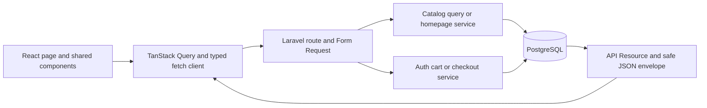
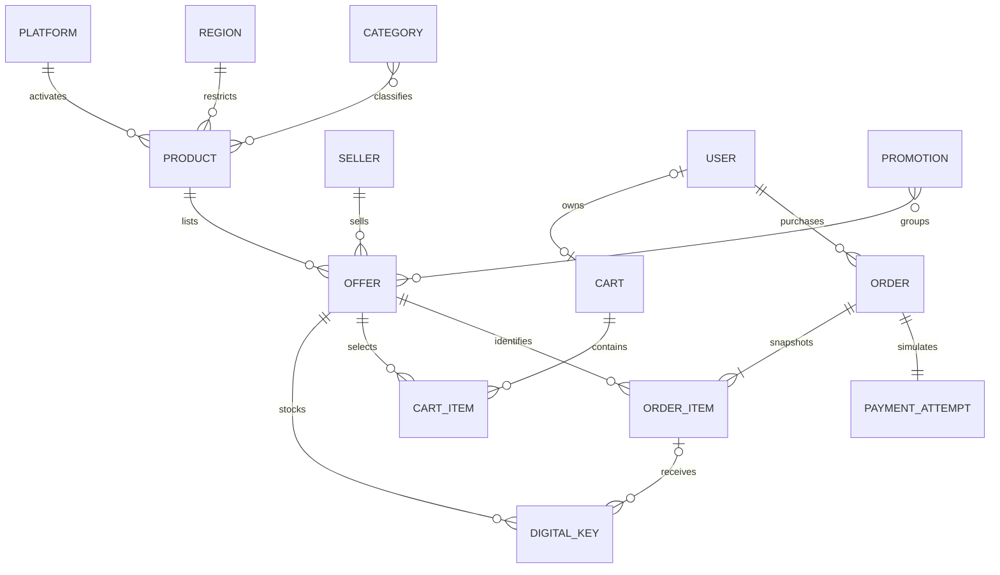

# Marketplace architecture and interview guide

Keymarket is a single Laravel application with a React storefront and PostgreSQL. Its strongest implemented slice is browsing a product, comparing sellers, retaining the chosen offer through authentication, simulating payment, and delivering a unique key. This guide describes the actual code, replacing proposed folder names in the original architecture roadmap where those differ.

## How one request moves through the system

Production serves compiled React and Laravel from one HTTPS origin through Nginx. Static assets are served directly; API calls reach Laravel; recognized frontend deep links return the SPA. Unknown API/static paths keep their error statuses. Cookie authentication therefore does not require cross-origin cookies. Docker/Render deployment is prepared; a public instance is not yet verified.

The backend is a **modular monolith**: the services are ordinary PHP classes within one application. Separate homepage providers satisfy independent data retrieval without introducing multiple servers, network hops or deployment pipelines.

## React responsibilities

| Actual code | What it does and why |
| --- | --- |
| [App.tsx](../frontend/src/App.tsx) | Defines the common shell and routes for home, store, product, cart, auth, checkout and orders |
| [HomePage.tsx](../frontend/src/pages/HomePage.tsx) | Composes six independently loading sections; a failed recommendation request does not remove the hero |
| [useCatalog.ts](../frontend/src/hooks/useCatalog.ts) | Gives each API resource its own query key and abort signal; caching/loading/errors stay consistent |
| [api.ts](../frontend/src/lib/api.ts) | Typed fetch wrapper, JSON/error handling and CSRF preparation for writes; no embedded API credentials |
| [StorePage.tsx](../frontend/src/pages/StorePage.tsx) | Treats URL parameters as catalog state, so refresh, sharing and browser Back preserve filters |
| [SearchBar.tsx](../frontend/src/components/SearchBar.tsx) | Debounces input and provides an accessible autocomplete combobox; requests ranked server results |
| [ProductCard.tsx](../frontend/src/components/ProductCard.tsx), [SellerOfferCard.tsx](../frontend/src/components/SellerOfferCard.tsx) | Render API contracts and navigate/add the exact seller offer; do not own pricing rules |
| [useCart.ts](../frontend/src/hooks/useCart.ts), [useSession.ts](../frontend/src/hooks/useSession.ts) | Coordinate mutations, invalidate server caches and expose current session/cart state |
| [CheckoutPage.tsx](../frontend/src/pages/CheckoutPage.tsx) | Reviews a backend quote, confirms a simulated outcome and retains the request identity for recovery |
| [tokens.css](../frontend/src/styles/tokens.css) | Centralizes colors, spacing and typography; shared components prevent visual drift |

Server state stays in TanStack Query. Temporary state, such as an open drawer or selected autocomplete result, stays in a component. React never decides what a customer owes or which inventory row can be sold. Static interface labels are permitted; product names, offers, prices, banners and taxonomy come from the API.

## Laravel layers and independent homepage data

Routes in [api.php](../backend/routes/api.php) select middleware and controllers. Form Requests check types, limits and allowed values. Controllers pass validated inputs to services/queries. Models define relationships and casts. Resources select public fields; they prevent accidental serialization of passwords, inventory ciphertext or private fingerprints.

| Endpoint under /api/v1 | Provider and selection |
| --- | --- |
| GET /home/banners | BannerService selects active records within schedule and stable display order |
| GET /home/categories | PopularCategoryService selects populated categories with eligible catalog content |
| GET /home/best-sellers | BestSellerService + RecentSalesQuery aggregate fulfilled units in the last 30 days |
| GET /home/deals | DealService ranks stocked active promotional offers by discount; comparison and sale prices belong to the same winning offer |
| GET /home/gift-cards | GiftCardService filters gift cards and ranks completed sales, then current price |
| GET /home/recommendations | RecommendationService ranks available seller ratings, offer depth and release date |

Recommendations are intentionally public discovery picks, identical for all visitors. Seeded historical fulfilled orders make best-seller rankings meaningful on a new installation. Failed payments do not count as sales. Services can reuse ProductQuery's eligibility/eager-loading code without sharing a hardcoded result array.

Other route groups:

| Routes under /api/v1 | Responsibility |
| --- | --- |
| GET /products, /products/{slug}, /offers, /offers/{id} | Catalog and detail reads |
| GET /categories, /categories/{slug}, /catalog/filters | Taxonomy and available facets |
| GET /search/suggestions | Bounded ranked autocomplete |
| GET /auth/session; POST /auth/register, /auth/login, /auth/logout | Session/account lifecycle |
| GET /cart; POST /cart/items; PATCH/DELETE /cart/items/{id} | Specific-offer cart mutations and current totals |
| GET /checkout/quote; POST /checkout | Authenticated review and idempotent simulated purchase |
| GET /orders, /orders/{id} | Current user's historical snapshots and fulfilled keys |

The [API contract](api-design.md) gives the exact validation/response shapes. Prices are integer EUR cents, avoiding floating-point money errors. Catalog reads avoid creating sessions; stateful cart/account operations use Laravel's web/CSRF middleware. Private responses are not publicly cacheable.

## Database schema in plain language

A **product** is one sellable edition/platform/region variant. A Steam Global listing and an Xbox Europe listing are separate products. An **offer** is a seller's price for that exact variant. The seller owns the rating; each displayed offer includes its seller's rating. Available stock is the count of unallocated, nonretired inventory keys, so a stock counter cannot drift from actual keys.

Categories use a pivot because one game can be both RPG and action. Each user has at most one account cart; guest carts have no user and are addressed through the server session. The cart stores offer and quantity, using current prices on reads. An order item stores immutable title/seller/platform/region/price snapshots so a later catalog edit cannot rewrite a receipt.

Foreign keys prevent orphaned relationships. CHECK constraints reject negative prices, invalid quantities, bad currencies and inconsistent timestamps. A unique inventory fingerprint rejects duplicate key material across offers. A composite foreign key ensures a key is allocated only to an order item for the same offer. Unique user/idempotency pairs prevent duplicate purchase records. Transactions enforce cross-row totals and allocation counts; a CHECK constraint alone cannot count related rows. Full definitions are in [database-schema.md](database-schema.md).

## Fuzzy search walkthrough

Open [ProductQuery.php](../backend/app/Queries/Catalog/ProductQuery.php), especially read(), listing() and search(). Both the store and suggestions use this class, so they share eligibility, relevance and filtering.

1. Normalize the search to lower case; use parameter bindings rather than inserting raw input into SQL.
2. Escape LIKE wildcards so a user typing percent or underscore does not accidentally request everything.
3. For one/two-character searches, use a bounded prefix. From three characters onward, include substrings and PostgreSQL trigram/word similarity candidates.
4. Rank exact matches before prefixes, then substrings, then fuzzy matches; use word similarity within those ranks and a stable product-ID tie-breaker.
5. Apply active seller/inventory and combined catalog filters in the database before pagination.

Trigrams compare overlapping groups of three characters. Most of `minecraf` overlaps `Minecraft`, so it remains a plausible candidate despite the missing final character. `elden` is a direct substring/prefix match. This is typo tolerance, not a promise to correct every possible misspelling.

The migrations install pg_trgm and matching expression indexes: GIN on lower(title) for trigram/substring candidates, and a prefix index for short searches. read() sets similarity thresholds locally inside a transaction and restores prior settings, preventing a reused connection from changing another query's behavior. For this small dataset, a database planner may still prefer a sequential scan. A dedicated search engine would add operational cost without evidence that it is needed here.

## Authentication walkthrough

Open [AuthController.php](../backend/app/Http/Controllers/Api/V1/AuthController.php), [SessionAuthService.php](../backend/app/Services/Auth/SessionAuthService.php), and [api.ts](../frontend/src/lib/api.ts).

Registration validates the request, creates a user through a hashing cast and merges the guest cart transactionally. Login validates credentials and merges the same exact offer lines into the saved account cart. Quantities are bounded and conflicts produce review notices. Both actions regenerate the session ID. Logout invalidates the session and rotates CSRF state; saved account carts stay owned by that account.

The client initializes /sanctum/csrf-cookie and sends the CSRF token for writes. The browser carries the session cookie, which is HttpOnly; JavaScript does not store a bearer token in localStorage. Production sets Secure and SameSite=Lax and uses persistent database sessions. auth:sanctum protects purchase/history routes. The server also scopes order queries by current user, so changing an order UUID cannot reveal someone else's keys.

Password hashing is one-way verification; inventory encryption must be reversible for authorized delivery. The malformed-email and bcrypt-length/null-byte cases are validated before hashing, returning 422 rather than a server error. Rate limiting and generic failed-login messages reduce simple enumeration/guessing opportunities. Recovery and email verification are deliberately outside this demo.

## Checkout and key delivery walkthrough

The central file is [CheckoutService.php](../backend/app/Services/Checkout/CheckoutService.php).

quote() reads authoritative current totals and creates a ten-minute authenticated-encrypted token binding the user, cart ID/version, selected offer IDs, quantities, prices, stock, platform and region. The browser displays this summary and asks for review. A quote does **not** reserve inventory or guarantee later availability.

The demo card form is a presentation layer over that protocol. DemoCardPayment retains cardholder/number/expiry/CVC/billing fields and the simulated verification code only in local component state, validates exactly three sample numbers, and clears state on submission or cancellation. It calls CheckoutPage with only approve or decline. CheckoutPage sends the existing quote token, idempotency UUID and scenario, with a synchronous duplicate-event guard. Only these three metadata fields can be stored for interrupted-request recovery; no card values are included. Verification is entirely local UI, while the server continues to enforce ownership, current stock/prices and unique key delivery. A lost result survives reload, temporary throttling and reauthentication using the same request UUID. [Card flow and test details](purchasing-milestone.md#advanced-demo-card-checkout--november-23-2026).

purchase() does the following inside one PostgreSQL transaction:

1. Lock the buyer row, then look for an existing order with this user and idempotency UUID. An identical request returns the original result, even if its response was lost. Reusing the UUID for different inputs returns a conflict.
2. Verify quote authenticity, owner and expiry. Lock the current cart and reject a changed version.
3. Lock offers in stable ID order. Check seller/product activity and available stock, then lock the exact required inventory rows for an approved scenario.
4. Compare current lines with the reviewed quote. A price, stock or compatibility change requires a fresh review; it is never silently substituted.
5. Create the order, immutable items and a terminal simulated payment attempt. On approval, allocate keys and clear/version the cart. On decline, retain stock/cart and allocate nothing.
6. Commit everything together. An exception rolls back the order, payment, allocation and cart changes together. Limited retries handle database deadlock/serialization failures.

**Why a transaction:** without it, a failure between saving the order and assigning inventory could leave a paid-looking receipt without keys. **Why row locks:** two buyers may both observe the final key before either writes; locking makes one transaction wait and recheck. **Why sorted locks:** consistent acquisition order reduces deadlocks across multi-offer carts. **Why idempotency:** a double-click or retry after a lost response must not consume additional keys.

[DigitalKey.php](../backend/app/Models/DigitalKey.php) uses Laravel's encrypted cast and HMAC-SHA-256 duplicate fingerprint. APP_KEY allows authorized decryption; a separate stable fingerprint secret detects duplicate normalized key strings. Losing/changing these independently of the database can break delivery/deduplication. They are configured outside source control.

[OrderController.php](../backend/app/Http/Controllers/Api/V1/OrderController.php) loads keys only after applying owner scope. [OrderResource.php](../backend/app/Http/Resources/OrderResource.php) reveals key text only for fulfilled detail with the key relation loaded. Public offers never contain keys, ciphertext or fingerprints. The model disallows reassigning an allocated key. Database access can bypass model hooks, so restricted write paths and DB constraints both matter.

This simulator performs no external payment call. A real provider would require payment-intent states, authenticated webhooks, reconciliation and carefully designed reservation/retry logic. Holding database row locks while calling a real payment network would be an unsuitable extension of this synchronous simulator.

## Interview answers and honest limits

| Interview question | A concise answer you can explain from the code |
| --- | --- |
| Why separate products and offers? | A product describes the entitlement; each seller sets its own price and owns separate inventory. The cart must remember the offer, not just the product. |
| Why derive stock instead of storing a number? | Counting unsold keys keeps availability tied to deliverable inventory. At higher scale I would measure query costs before introducing a transactional counter. |
| Why PostgreSQL search? | pg_trgm handles the required partial/typo queries and indexes in the existing database. I avoided operating another search system for 45 demo variants. |
| Why separate homepage services? | Each section has distinct selection rules, endpoint and query key. One failing provider has its own retry state, and the other sections still render. |
| Why cookie auth rather than tokens in browser storage? | React and Laravel share an origin. Sanctum sessions and CSRF fit that model and avoid JavaScript-held bearer credentials. |
| What prevents overselling? | Transactional offer/key locks, availability rechecks, unique fingerprints and correct offer/item relationships; independent-process race tests demonstrate last-key behavior. |
| What prevents duplicate charges/orders? | There are no real charges. A unique user/request UUID plus matching payload hash makes simulated purchase retries return the same order. |
| How is artwork selected? | Backend seed paths select locally bundled, attributed game covers; one manifest records exact sources and edition checks. Gift cards are demo compositions, hero art is original, and attribution does not imply an open licence. MarketplaceImage reserves layout space and handles both primary and fallback failures. |
| What would you build next? | First execute production CI/Docker and verify public deployment; then account recovery/email verification and operational monitoring. Real payments/seller tooling need additional product and security design. |

Local tests prove the implemented demo behaviors under the tested configuration. They do not prove cloud uptime, unrestricted typo correction, complete accessibility conformance, or real-world region entitlements. The project is published on [GitHub](https://github.com/Farid1324/Project_clone); public deployment is still unverified. Use the [requirements checklist](submission-checklist.md) to distinguish these delivery gaps from implemented application functionality.

## Persistent wishlist

WishlistButton is a sibling of each ProductCard navigation link and is also reused in ProductPage. Heart controls support aria-pressed, keyboard operation and explicit pending/error feedback. WishlistPage reuses ProductGrid, LoadingSkeleton, AsyncState and the existing auth gate. Header shows the complete saved count, independent of the visible page. A guest heart returns through the existing login/register flow with an allowlisted product UUID, then completes the idempotent save and removes that intent from the URL.

useWishlist.ts keeps user-scoped query keys for summary and paginated products. Save/remove wait for a server response, so no optimistic rollback is needed. A successful mutation updates the shared summary and invalidates saved-product pages. Failed writes refetch authoritative data. Login/logout cancel private reads and in-flight wishlist writes, then remove private wishlist query entries and mutation responses. Aborting before an auth change prevents a delayed old Set-Cookie response from replacing the new session. A write already committed remains persisted; the next owner read retrieves it. A failed auth operation refetches the current account's wishlist to reconcile that ambiguous result. Late callbacks additionally check account identity, and wishlist 401 handling is scoped to the originating account.

Laravel WishlistController uses Sanctum, existing web/CSRF/private-response middleware, Form Requests, and WishlistService. The service stores a user/product association, not an offer, price or stock snapshot. User-row transaction locks and a unique user/product index make repeated or concurrent writes safe. Lists reuse ProductQuery/ProductResource and keep sold-out/unpublished saved products visible. Only this private owner-filtered query opts into unpublished products. A hidden listing has no detail link, while sold-out published listings can still open for seller comparison.

See [API contract](api-design.md#wishlist-contract), [schema](database-schema.md#persistent-product-wishlist), and [verification and commands](wishlist-milestone.md). This feature adds no dependencies, secrets, queues or public wishlist sharing.
