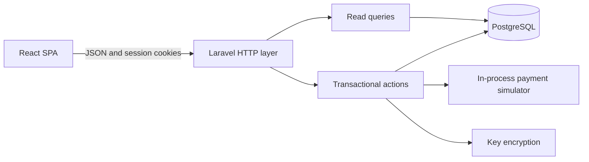

# Architecture proposal

For the final implemented architecture and simple code walkthrough, read [architecture-explained.md](architecture-explained.md). This original proposal remains historical planning context.

Status: original M0 system proposal, retained as the roadmap, with current implementation notes. The [backend milestone](backend-milestone.md) implemented the relational schema; the responsive UI and six homepage providers are described in [ui-milestone.md](ui-milestone.md) and [homepage-milestone.md](homepage-milestone.md). The [purchasing milestone](purchasing-milestone.md) now implements Sanctum session authentication, guest-cart merging, transactional simulated checkout and owner-only key history. It is the current authority for the delivered purchase flow; remaining proposal sections below describe architectural intent and future extensions. Decisions are project choices unless a source is linked.

## Scope and technical baseline

Current integration and deployment status: the [assignment audit](assignment-audit.md) verifies all requested local journeys over compiled HTTPS and prepares a single-origin Render/Neon configuration. Public deployment remains unperformed; the [deployment guide](deployment.md) records its configuration and verification requirements. The older proposal details below remain architectural context.

The first complete journey is **search a game, compare independent sellers, add an offer to a cart, authenticate, simulate payment, and reveal a purchased key**. Every milestone must leave its delivered slice usable and testable.

Use React with TypeScript and Vite, Tailwind CSS, Laravel 13 on PHP 8.4, PostgreSQL 18, and Sanctum. Laravel 13 supports PHP 8.3–8.5. Pin compatible dependency versions and commit lockfiles during scaffolding. [Laravel release policy](https://laravel.com/framework/docs/13.x/releases).

The installed Node version is 24.14.0. Verify the selected Vite release's engine constraints during installation. Use the `react-ts` template and Tailwind's Vite integration. [Vite setup](https://vite.dev/guide/), [Tailwind Vite integration](https://tailwindcss.com/docs/installation/using-vite).

Initial scope uses EUR integer minor units, English UI, simulated payment only, and seeded independent sellers. A product represents one game edition/platform/activation-region combination. Product details explain activation restrictions; this demo will not claim country-by-country eligibility verification. Keys are explicitly nonredeemable demo inventory. Wishlists were originally deferred and are now implemented in the [wishlist milestone](wishlist-milestone.md). Continue to defer seller onboarding, reviews, personalized recommendations, coupons, real payment providers, refunds, currency conversion, and administration screens.

## Application boundaries



Use a modular monolith: one deployable API with conventional Laravel models and cohesive action/query classes. Homepage services under app/Services/Home own section selection and ranking. RecentSalesQuery shares the fulfilled-sales aggregate, and ProductQuery shares offer eligibility and eager loading. These are in-process classes in the same Laravel application.

HTTP controllers authorize, validate through Form Requests, invoke one query/action, and serialize through API Resources. Query classes contain filtering, joins, aggregates, and pagination. Action classes own mutations and transaction boundaries. Models define relationships, casts, and narrow reusable scopes. Policies enforce cart/order/key ownership. Avoid generic repositories over Eloquent and interfaces with only one speculative implementation.

Frontend pages orchestrate feature components. The implemented read client uses native fetch with AbortSignal; cart mutations initialize Sanctum's CSRF cookie and send its token on same-origin requests. TanStack Query handles ordinary server state; React Router handles navigation and URL filters. Component state holds transient UI choices. The server owns cart contents, pricing, stock, orders, and authentication. Do not duplicate server state in a global Redux store.

The [product milestone](product-milestone.md) implemented `Services/Cart/CartService`. `Services/Auth/SessionAuthService` now merges guest carts within account limits; `Services/Checkout/CheckoutService` owns quote creation, idempotent purchase and allocation. Session blocking protects browser session updates, and PostgreSQL user/cart/offer/key locks protect purchases independently of session locks. Two independent PHP workers are observed concurrently waiting in pg_stat_activity before tests release the parent lock. Last-key competition yields one winner, and simultaneous duplicate requests yield one order. Real HTTP browser tests separately cover CSRF, session rotation/revocation and cross-account order privacy. No real payment provider is involved.

Begin with explicit TypeScript resource types and API response tests. Add a machine-readable OpenAPI contract alongside implemented endpoints as they stabilize, rather than generating an enormous speculative client now.

## Proposed folder structure

This is the target structure, not a claim that these files exist in M0. Create folders when their milestone needs them.

```text
/
  README.md
  compose.yaml
  .env.example                 # Compose configuration; no actual secrets
  docs/
    architecture.md
    database-schema.md
    api-design.md
    implementation-plan.md
    ai-chat-history.md
  backend/
    app/
      Actions/
        Auth/                 # register, login, logout
        Cart/                 # item mutations and login merge
        Checkout/             # one transaction and idempotency
      Queries/
        Catalog/              # ProductQuery, search, shared RecentSalesQuery
        Home/                 # PromotionsQuery
        Orders/               # owner-scoped history/detail
      Services/
        Home/                 # Six section services (implemented)
        Payments/             # SimulatedPayment (planned), no remote I/O
      Http/
        Controllers/Api/V1/
        Requests/
        Resources/
      Models/
      Policies/
      Enums/
    bootstrap/app.php
    config/
    database/{migrations,factories,seeders}/
    routes/{api,web}.php
    tests/{Unit,Feature,Concurrency}/
    composer.json
    composer.lock
    Dockerfile
    .env.example
  frontend/
    src/
      app/                    # router, providers, shared shell
      features/
        home/                 # independent section hooks/components
        catalog/              # store, filters, product details
        search/               # global combobox using catalog search
        auth/
        cart/
        checkout/
        orders/
      components/ui/
      lib/                    # HTTP client, money formatting
      types/api.ts
      styles/app.css
    public/images/            # licensed or original demo assets
    package.json
    package-lock.json
    vite.config.ts
    .env.example
  e2e/
  .github/workflows/ci.yml
```

## Catalog and search

Products are distinct from offers. Sellers set offer prices independently; inventory is a collection of encrypted individual keys per offer. An offer is purchasable only if product, seller, and offer are active and at least one unsold, nonretired key exists.

Build one reusable available-offer subquery. Derive the product card's minimum price, discount, and eligible offer count from that same set. Never combine a price from an unavailable offer with stock from a different seller. Avoid N+1 queries through set-based aggregates and eager loading.

Store filtering supports platform, activation region, category, price range, and availability. Catalog sorting supports price ascending/descending, recent fulfilled sales (popularity), newest catalog entry and relevance. The current implementation and verified search behavior are detailed in [catalog-milestone.md](catalog-milestone.md). Multiple values within one facet use OR; different facets use AND. Price bounds must match a single eligible offer. When price filters apply, display the minimum among matching offers. Pagination follows product aggregation so multiple sellers never duplicate a product row. Apply a final product-ID tie-break to all sorts.

Global suggestions and the full store use the same search query class. Normalize input consistently, bind parameters, escape LIKE wildcards, and allow only predefined sort values. Support exact title, prefix, substring, and typo matches. PostgreSQL `pg_trgm` supplies similarity operators and GIN index support for similarity and `ILIKE`. Use indexable candidate predicates, then rank exact/prefix/substring above fuzzy matches, with word similarity to avoid penalizing a short query against a long title. [PostgreSQL 18 pg_trgm](https://www.postgresql.org/docs/18/pgtrgm.html).

Plan a GIN index on `lower(title)` and use the same expression in SQL. Tune thresholds with representative fixtures, including `elden`, `eldn ring`, and `cyberpnk`; do not claim arbitrary typo correction. Queries of one or two characters use bounded prefix matching, with a corresponding pattern index; suggestions require at least two characters. Frontend suggestions debounce approximately 250 ms, cancel superseded requests, support keyboard navigation, and never display stale results. Search terms and filters live in the URL.

Choose PostgreSQL search to keep relevance and inventory in one system. Elasticsearch or Meilisearch would improve specialist search features at the cost of a second service and index synchronization. Revisit only after measuring a real limitation.

## Independent homepage data

| Section | Endpoint | Dedicated provider and data source |
| --- | --- | --- |
| Promotional banners | `GET /api/v1/home/banners` | `BannerService`: active rows in their UTC start/end window, ordered by priority and ID |
| Popular categories | `GET /api/v1/home/categories` | `PopularCategoryService`: recent fulfilled sales on available products; then available product count/name/ID |
| Best-selling games | `GET /api/v1/home/best-sellers` | `BestSellerService`: fulfilled game quantities from the last 30 days, then joined to current available offers |
| Deals | `GET /api/v1/home/deals` | `DealService`: available offers in active campaigns with a genuine discount; choose one qualifying offer per product |
| Popular gift cards | `GET /api/v1/home/gift-cards` | `GiftCardService`: current available gift cards ranked by recent fulfilled quantity; price/ID fallback |
| Recommended products | `GET /api/v1/home/recommendations` | `RecommendationService`: public discovery ranking by available seller rating, seller depth and product dates |

Banners use database-managed copy, image paths, alt text, and a typed store/product destination. For each deal, its current price, comparison price, and discount all belong to the same winning offer. Rank by percentage discount, then price, then product ID. Best-seller ties use product ID. No historical sales means an empty best-seller section; never silently replace it with popular-looking hardcoded products.

Each section issues its own React request and has its own loading, error, empty, and retry states. One failed endpoint does not block the other sections. Static layout and headings can live in React; product titles, images, prices, banners, discounts, and merchandising results come from the API. Seed data lives in Laravel, never in React arrays or runtime mock handlers. Tests may use isolated HTTP fixtures.

Start without server-side response caching so inventory stays easy to reason about. Client freshness is for display only; checkout always requeries the database. Add scoped caches and invalidation only after measuring query costs.

## Authentication and cart

Use Sanctum's first-party SPA session authentication: session cookies and CSRF protection, with `auth:sanctum` protecting private endpoints. Fetch `/sanctum/csrf-cookie` before mutations and send credentials and the XSRF header. Configure trusted origins including the development port, stateful middleware, session cookies, and session regeneration at login. Production uses HTTPS and a shared origin/domain. [Sanctum SPA authentication](https://laravel.com/framework/docs/13.x/sanctum#spa-authentication).

The browser uses relative API URLs. Vite proxies `/api`, `/sanctum`, and `/up` to Laravel in development. A production reverse proxy serves the SPA and forwards API/session routes to PHP. Configure only explicit trusted origins if separate subdomains are later used.

Persist guest carts in PostgreSQL; their UUID is held in the server session. An authenticated cart belongs to its user, with one user cart enforced in the database. Never authorize a cart using a client-supplied cart ID. Cart routes need stateful session middleware even for guests. CSRF protection applies to guest mutations too.

On registration/login, lock and merge the guest and account carts in deterministic cart-ID order. Combine identical offer quantities up to the documented limit of nine and return adjustment messages. Preserve every distinct line, including unavailable lines. If merging exceeds the 20-line checkout limit, retain the lines and show a warning requiring the shopper to trim the cart before purchase; block further additions at that limit. Do not reserve keys or silently remove items. Increment the cart version on every cart mutation or merge. Logout invalidates the session; the account cart remains for its owner and the next guest receives a new cart.

The cart response is a current quote, not a price guarantee. Include its version and a SHA-256 fingerprint over canonical cart ID, version, currency, and sorted offer/quantity/current-price lines. The fingerprint detects stale quotes; it is not authorization and does not make client prices trustworthy. Checkout computes all money values again.

## Checkout correctness

Keep simulated checkout synchronous and entirely local. No stock reservations or asynchronous payment states are needed because the simulator makes no network calls. A future real provider requires a reservation/payment reconciliation design; it cannot simply be invoked while database locks are held.

1. Require authentication, a valid UUID `Idempotency-Key`, cart version, quote hash, and explicit demo payment scenario. Reject client-supplied totals or prices.
2. Start a transaction and lock the user's cart. Check for a previous order with the same user/key before validating the now-current cart. An identical retry returns that order; a different request fingerprint returns `409`.
3. Validate the nonempty cart, 20-line maximum, quantity limits, and version. Lock affected offers in ascending ID order, and recheck current availability, prices, and the quote hash. Inventory maintenance must also lock the affected offer before modifying its keys. Active-state writers must follow this locking contract too.
4. Select enough unsold, nonretired keys for each offer using row locks and deterministic key ordering. A shortage rejects the whole cart with `409`; no partial order is created.
5. Create the order and immutable line snapshots. Run the deterministic in-process simulator. A decline creates a terminal `payment_failed` order and payment record, retains the cart, and assigns no keys.
6. An approval assigns keys to their order items, records the approved payment, marks the order fulfilled, clears the cart, and increments its version. Commit these writes together. An exception rolls the transaction back.
7. Return order metadata. Deliver plaintext keys through a separate owner-authorized reveal endpoint after commit.

The unique `(user_id, idempotency_key)` constraint is a final guard against duplicate orders. Serialize same-user requests using the single account cart. Bound deadlock retries and execute no external side effects in the retried closure. Identical approved retries return the original order even after its cart was cleared; declined retries return the original decline. Changing a payment scenario requires a new key and current quote.

Store ciphertext and a secret-keyed fingerprint for duplicate detection, never plaintext. Reveal checks ownership and fulfilled status, returns `Cache-Control: no-store`, and is rate limited. Key plaintext stays out of ordinary resources, logs, browser persistence, analytics, and TanStack Query caches. Keep the reveal response only in short-lived component state and clear it on navigation/logout. Encryption and fingerprint secrets must remain stable for existing inventory.

## Visual direction and operational scope

Use Eneba as a layout reference: a prominent global search, promotional banners, dense offer cards, and clear account/cart access. Its current public page exposes search, login/register, category navigation, promotions, and game sections. This proposal is inspired by that structure, not a pixel-accurate reproduction. [Eneba homepage](https://www.eneba.com/).

Use an original identity with a deep purple background, brighter purple surfaces, and a high-contrast accent for prices/actions. Build reusable card, badge, input, button, dialog, skeleton, and notice components. Show activation platform/region and seller identity before purchase. Use a mobile filter drawer, desktop sidebar, responsive card grids, keyboard-operable search/dialogs, visible focus, labeled controls, and reduced-motion support. Avoid auto-advancing banners in the first version.

Use structured request IDs and operational logs without credentials, key plaintext, payment payloads, or personal request bodies. Provide readiness separately from liveness. Deployment needs a PHP-capable runtime plus PostgreSQL and a reverse proxy; static hosting alone cannot run this API. M0 does not provision hosting or publish anything.
