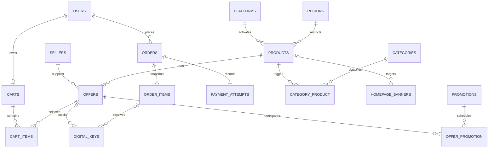

# Implemented relational database

Status: implemented in seven migrations under `backend/database/migrations/` and exercised against PostgreSQL. Business fields are NOT NULL unless marked nullable; Laravel-managed created/updated timestamp columns are nullable bookkeeping fields. Use PostgreSQL 18 with `pg_trgm`. All domain primary keys are UUIDs, serialized as strings. Domain timestamps use `timestamptz` in UTC. Monetary values use integer minor units; currency is fixed to `EUR` in this version. All mutable entities have `created_at` and `updated_at`; pivot tables use composite primary keys. Indexes target listing, price, availability, and history access paths.

## Relationships

Guest carts have a nullable user FK; cart endpoints resolve ownership through a server-side session pointer. Authenticated ownership takes priority when a session has a user. No request accepts a cart owner or cart ID. Registration/login merge guest lines into the saved account cart. The ERD shows purchase cardinalities enforced by CheckoutService: fulfilled items receive exactly their requested key quantity and an approved simulated payment; declined attempts receive no keys and retain the cart.

## Tables

| Table | Principal columns | Constraints and meaning |
| --- | --- | --- |
| `users` | `id`, `name varchar(120)`, `email varchar(254)`, `password varchar(255)`, nullable `remember_token` | Unique index on `lower(email)`; normalize email on input. Password uses Laravel hashing. |
| `sellers` | `id`, `name varchar(120)`, `slug varchar(160)`, `status varchar(20)`, `rating numeric(3,2)`, `rating_count integer` | Unique slug; status `active` or `suspended`. Rating is between 0 and 5; count is nonnegative. Each offer exposes the rating of its seller; ratings are not duplicated per offer. Sellers are seeded businesses, not user roles. |
| `platforms` | `id`, `name varchar(80)`, `slug varchar(100)`, `activation_instructions text` | Unique slug. |
| `regions` | `id`, `code varchar(20)`, `name varchar(100)`, `activation_notice text` | Unique code such as `GLOBAL`, `EU` or `US`; region is an activation restriction, not a currency. |
| `categories` | `id`, `name varchar(80)`, `slug varchar(100)`, `description text` | Unique slug. |
| `products` | `id`, `platform_id FK`, `region_id FK`, `slug varchar(200)`, `title varchar(200)`, `type varchar(20)`, nullable `edition varchar(100)`, `description text`, `cover_image_path varchar(255)`, nullable `publisher varchar(160)`, nullable `release_date date`, `is_active boolean` | Unique slug. Type is game or gift_card. One sellable game/edition/platform/region variant per row. Descriptions are plain text in the first version. |
| `category_product` | `category_id FK`, `product_id FK` | Composite PK `(category_id, product_id)` plus reverse index. |
| `offers` | `id`, `product_id FK`, `seller_id FK`, `price_minor integer`, nullable `comparison_price_minor integer`, `currency char(3)`, `is_active boolean` | Unique `(product_id, seller_id)`; `price_minor > 0`; comparison is null or greater than/equal to price; `currency = 'EUR'`. Product and seller links are immutable. |
| `digital_keys` | `id`, `offer_id FK`, `key_ciphertext text`, `fingerprint char(64)`, nullable `order_item_id`, nullable `allocated_at`, nullable `retired_at` | Unique fingerprint. Unsold stock has no order item and is not retired. Assignment and timestamp are both null or both present. Allocated keys cannot be retired. Use composite FK described below. |
| `carts` | `id`, nullable `user_id FK`, `version bigint default 1` | Unique non-null user ID; multiple guest rows allowed. `version >= 1`. Guest ownership lives in server sessions. |
| `cart_items` | `id`, `cart_id FK`, `offer_id FK`, `quantity smallint` | Unique `(cart_id, offer_id)`; quantity between 1 and 9. Cart holds offer IDs, not stale persisted prices. |
| `orders` | `id`, `user_id FK`, `idempotency_key uuid`, `request_hash char(64)`, `status varchar(24)`, `currency char(3)`, `total_minor bigint`, nullable `fulfilled_at` | Unique `(user_id, idempotency_key)`; total nonnegative; EUR only; status `fulfilled` or `payment_failed`; fulfilled timestamp present exactly when fulfilled. No pending order is committed in this simulator design. |
| `order_items` | `id`, `order_id FK`, `offer_id FK`, `product_title_snapshot varchar(200)`, `seller_name_snapshot varchar(120)`, `platform_name_snapshot varchar(80)`, `region_name_snapshot varchar(100)`, `unit_price_minor integer`, `quantity smallint`, generated `line_total_minor bigint` | Quantity 1–9; positive unit price; line total is unit price multiplied by quantity. Unique `(order_id, offer_id)` and `(id, offer_id)`; snapshots are immutable. |
| `payment_attempts` | `id`, `order_id FK`, `provider varchar(20)`, `scenario varchar(20)`, `status varchar(20)`, `reference uuid`, `amount_minor bigint` | Unique order ID and reference. One terminal simulated attempt per order; provider `simulated`, scenario `approve`/`decline`, status `approved`/`declined`; amount nonnegative. A new attempted purchase uses a new order/idempotency key. |
| `homepage_banners` | `id`, `title varchar(160)`, nullable `subtitle varchar(240)`, `image_path varchar(255)`, `image_alt varchar(240)`, `destination_type varchar(20)`, nullable `product_id FK`, `sort_order integer`, `is_active boolean`, nullable `starts_at`, nullable `ends_at` | Destination is `store` with null product or `product` with a product ID. End must be after start when both exist. Window uses inclusive start/exclusive end. Do not store arbitrary executable URLs. |
| `promotions` | `id`, `slug`, `title`, `description`, `image_path`, `is_active`, nullable `starts_at` / `ends_at` | Unique slug; end must follow start. Promotions collect seller offers and do not duplicate or override offer prices. |
| `offer_promotion` | `offer_id FK`, `promotion_id FK` | Composite PK, reverse index; many campaigns may contain an offer. Active schedule gates homepage deals. |

Framework-owned tables include database-backed sessions with a UUID-compatible nullable user_id, password reset tokens, cache/cache locks, jobs/batches/failures, and the migrations table. Sanctum SPA foundation uses session cookies; no bearer-token issuance endpoint or personal-access-token table is supplied in this milestone.

## Inventory and accounting integrity

`digital_keys (order_item_id, offer_id)` references `order_items (id, offer_id)` with ordinary MATCH SIMPLE behavior: unallocated keys have a null item; allocated keys must refer to an item for the same offer. The corresponding unique pair on `order_items` supports that FK. Also retain the ordinary `digital_keys.offer_id` FK.

Use CHECK constraints for permitted status values, quantities, currency, positive prices, timestamp pairing, banner destination consistency, and comparison prices. Use generated line totals with bigint arithmetic. Cross-row invariants need a transactional action and integration tests: order totals equal line totals; payment amount equals order total; fulfilled items receive exactly their quantity of keys; failed orders receive none; approved payments correspond to fulfilled orders.

Key ciphertext uses authenticated Laravel encryption. Compute fingerprints using HMAC-SHA-256 with a separate stable inventory fingerprint secret over a defined normalized key representation. This permits duplicate detection without storing plaintext. Do not generate a new secret on each boot or reseed. No key-reveal endpoint is public. Future reveal actions must authorize before accessing the decrypting model cast.

Keys are assigned once; the checkout action must select only rows with null allocation and retirement fields while holding offer/key locks. No general update endpoint can reassign keys. Catalog/accounting rows referenced by historical orders use RESTRICT deletion. Archive products, sellers, and offers through their active/status fields; retain snapshots and inventory assignment. User deletion and refunds are outside the initial scope. Cart deletion may cascade only to its items; product/category deletion may cascade through their pivot, subject to catalog FKs.

## Implemented indexes

| Index | Query purpose |
| --- | --- |
| `products USING GIN (lower(title) gin_trgm_ops)` | Substring/fuzzy candidates using the matching lower-case expression |
| `products (lower(title) text_pattern_ops)` | Bounded short prefix queries |
| Unique product slug and taxonomy slugs/codes | Detail and facet lookup |
| `products (platform_id, region_id)` and separate region FK index | Common variant filtering and FK access |
| `category_product (product_id, category_id)` | Reverse category lookup |
| `offers (product_id, price_minor, id) WHERE is_active` | Eligible per-product price selection; seller activity checked by join |
| `offers (seller_id)` | Seller activity filtering and FK access |
| `digital_keys (offer_id, id) WHERE order_item_id IS NULL AND retired_at IS NULL` | Available inventory count and deterministic allocation |
| `digital_keys (order_item_id)` | Owner-authorized delivery retrieval through order items |
| Unique `carts(user_id)` | Single authenticated cart and checkout serialization |
| Unique `cart_items(cart_id, offer_id)` plus `cart_items(offer_id)` | Cart lines and FK access |
| `orders (user_id, created_at, id)` | Owner history pagination |
| `orders (fulfilled_at, id) WHERE status = 'fulfilled'` | Best-seller time window |
| `order_items (order_id, offer_id)` and `order_items (offer_id)` | Order detail, sales aggregates, FK access |
| `homepage_banners (is_active, sort_order, id)` | Ordered banner selection |

All existing PK/UNIQUE indexes also apply. Benchmark actual query plans before adding more indexes; small fixture datasets may legitimately use sequential scans. The first release derives stock from keys and minimum prices from offers rather than maintaining counters that can drift.

## Seed strategy and current scope

The transactional, repeatable DemoMarketplaceSeeder supplies 45 product listings: 25 PC game variants, 12 console games, and eight gift cards. Each has three independent seller offers, for 135 total offers. There are nine categories, four platforms, three activation regions (Global, Europe and US), three fictional rated sellers, two campaigns, three banners, and original local SVG artwork. Prices and ratings are illustrative demo fixtures, and all inventory is nonredeemable.

Stable key-slot fingerprints and historical-order UUIDs prevent duplicate inventory or sales on reruns. Allocated slots are never replaced with fresh stock. Sixteen historical fulfilled demo orders (twelve game orders and four gift-card orders) have matching item totals, approved simulated payment records, and exactly the requested number of assigned keys. A demo user/account cart is also seeded. Production demo seeding is refused by default; the hosted internship demo can explicitly opt in through ALLOW_DEMO_SEEDING. Startup seeds only an empty catalog when SEED_DEMO_ON_FIRST_BOOT is enabled. See deployment.md for stable-secret and migration requirements.

Public catalog/homepage queries, session-owned cart mutations, Sanctum cookie authentication, guest merging, simulated checkout and private order/key retrieval are implemented. Cart transactions lock the cart and selected offer, enforce current availability and limits (nine keys per offer, twenty offers), and increment version on changes. Reads quote current prices and retain unavailable lines. Checkout locks the owner row, cart, sorted offers and selected inventory, checks the authenticated-encrypted quote, writes immutable item snapshots and a terminal simulated payment, and atomically assigns keys/clears the cart only on approval. Declines retain inventory and cart. Owner-scoped detail is the only HTTP resource that decrypts fulfilled demo keys. Cross-row totals and allocation counts are verified by checkout and forced-rollback tests, with independent-process tests for last-key competition and duplicate requests. CHECK constraints alone cannot prove cross-row accounting. See [purchasing milestone](purchasing-milestone.md).

The seventh migration adds nullable product detail fields: `requirements jsonb`, `delivery_information text`, and `compatibility_notice text`. Requirements contain `kind` (`pc` or `activation`), `minimum`/`recommended` arrays of `{label, value}`, notes, optional source URL/capture timestamp, and product-specific `activation_steps`. The API joins activation steps into the existing newline-delimited activation instructions field, with platform instructions as a fallback. No HTML is rendered from requirement data. These fields are detail-only API content, leaving catalog cards compact. All seeded listings receive metadata; unseeded rows can honestly report missing requirements. See [metadata provenance](product-data-provenance.md).

See [setup commands](backend-setup.md), [implemented API](api-design.md), and [milestone report](backend-milestone.md).
