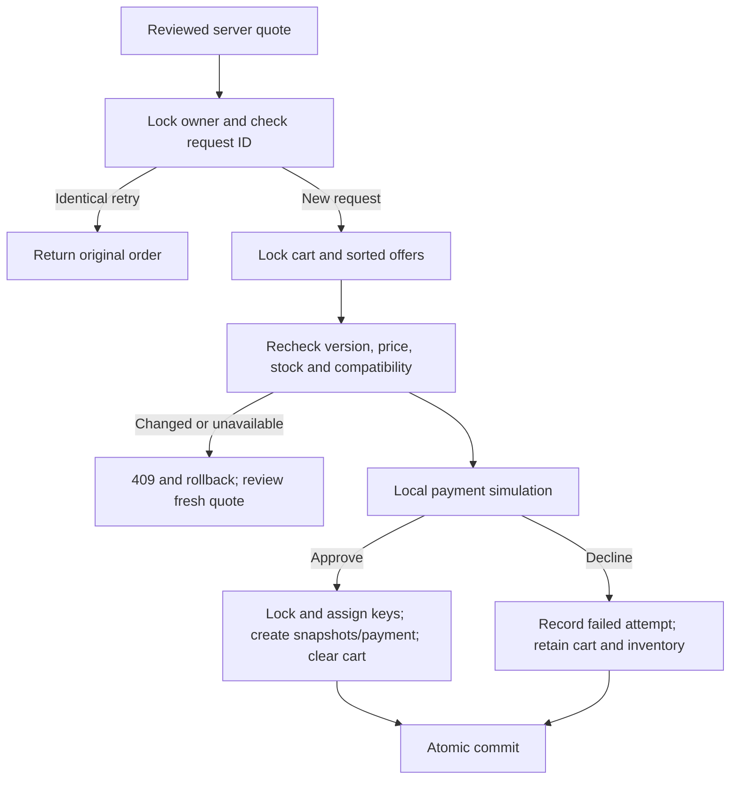

# Authenticated simulated purchasing

Implemented November 20, 2026. Registration, login/logout, saved carts, authenticated checkout, successful/declined payment simulations, digital demo-key confirmation and private order history now form a complete usable journey. No real credit cards, money, payment SDKs or external payment services are involved.

## Run and try it

From the repository root on the configured Windows environment:

```powershell
.\scripts\local-database.ps1 start
Set-Location backend
& ..\.tools\php\php.exe artisan migrate --no-interaction
& ..\.tools\php\php.exe artisan db:seed --no-interaction
& ..\.tools\php\php.exe artisan serve --host=127.0.0.1 --port=8000
```

In another terminal, from the repository root:

```powershell
npm.cmd ci --prefix frontend
npm.cmd run dev --prefix frontend
```

For a fresh installation, run `.\scripts\setup-local.ps1` first. Global PHP users can substitute `php` for the portable executable. [Full native and Docker setup](backend-setup.md).

Open `http://127.0.0.1:5173/store`, select a product and specific seller, add it to your cart, then sign in or register. Local seeded login is `demo@keymarket.test` / `[retired shared password removed; register a new account]`; creating your own demo account gives an initially empty history. Registration/login bring your guest cart into the account. Review checkout, check the confirmation box, and choose the successful or failed simulation. Successful simulation shows your nonredeemable keys; failed simulation retains your cart and offers another attempt. The account icon opens sign-out and order history.

No new migration was necessary: the seven existing migrations already define the user/session, offer/cart, order/payment and encrypted-key relationships. Running migrations reported nothing pending. Seeding updates the delivery explanation and retains existing allocations, orders and secrets. Do not reset a populated database or regenerate its encryption/fingerprint secrets. Browser purchase tests and captures create demo accounts/orders and consume demo stock; they belong on local demo fixtures.

## Authentication and cart ownership

The SPA uses Laravel Sanctum over the Laravel web session. Registration/login rotate the session ID; logout invalidates the old session and rotates CSRF. Real HTTP tests demonstrate that saved pre-login and logged-out cookies cannot access protected orders. Session cookies are HttpOnly/SameSite=Lax in the verified local configuration; production forces Secure cookies and requires HTTPS. There is no bearer-token issuance, and bearer-token retrieval is explicitly disabled for this first-party SPA.

Passwords use the existing User `hashed` cast and bcrypt. Registration accepts passphrases of at least twelve characters and at most 72 UTF-8 bytes, preventing bcrypt truncation. Email is trimmed/lowercased and backed by the case-insensitive database unique index. Login uses a generic credential error and timeboxed validation, rehashing when the configured cost changes. Input is strictly validated, with per-IP and per-email/IP auth throttles. Private endpoints use auth:sanctum and CSRF/session middleware; no owner, cart ID, client price or card fields are accepted by checkout. API authentication failures return JSON 401 even without a JSON Accept header.

`SessionAuthService` locks the user and merges the guest cart into the saved cart. An account without a saved cart claims the guest cart. Matching offer IDs combine quantities; different sellers remain separate lines. Saved lines have priority at the twenty-offer limit, combined quantities cap at nine, and any omitted/capped guest quantities generate visible merge notices. Stock shortages remain visible for review rather than silently changing sellers or prices. Logout retains the account cart but exposes an empty guest cart. Effective changes increment cart version.

Sensitive API responses use `Cache-Control: no-store, private`. Keys are encrypted at rest, with a separate stable HMAC fingerprint secret and database uniqueness to reject duplicate inventory. Only the authenticated owner's order-detail query loads/decrypts fulfilled keys. History lists, checkout responses, public catalog, logs and browser persistence do not contain plaintext keys. Client caches are cleared on account changes and protected-request 401s, including server revocation from another tab.

## Checkout transaction

GET `/api/v1/checkout/quote` returns a current backend-calculated cart plus an authenticated-encrypted ten-minute quote. The quote binds user, cart ID/version, selected offer IDs, quantities, prices, exact available stock, and product/platform/region IDs. It reserves nothing. The UI displays platform/region, seller, stock, line totals, total, check time and expiry, then requires review before payment.

POST `/api/v1/checkout` accepts only the quote token, UUID idempotency key and `approve`/`decline` scenario. `CheckoutService::purchase` performs this sequence inside `DB::transaction(..., 3)`:

1. Lock the user row and look for an existing order for that user's idempotency key. An identical token/scenario hash returns the original order, even after its quote expires or the cart is cleared. A different body with that ID returns 409.
2. Decrypt/validate the quote, lock the owner's cart, and check its version and nonempty contents.
3. Lock all selected offers in ascending UUID order. Recheck product/offer/seller publication, stock, prices and compatibility. Changed, expired or insufficient data returns 409 before any order commits. Even stock changes that leave enough inventory require a fresh review.
4. For approval, select the exact quantity of available keys under row locks, in deterministic UUID order. No SKIP LOCKED shortcut reports another buyer's locked stock as sold out prematurely.
5. Calculate totals from the locked database prices. Create terminal order/item snapshots and a matching simulated payment. Approval assigns the selected keys, clears cart lines and increments cart version. Decline records payment_failed snapshots/payment, retains the cart and assigns no keys.
6. Commit every change together. Any exception, including a forced failure after an allocation write, rolls back all order/item/payment/allocation/cart changes.



The transaction is necessary because checking stock and updating an inventory row are separate statements. Without locks, two buyers could both observe the last key as available. The offer/key locks make the second buyer wait and recheck after the first commits; the transaction also prevents an order/payment from surviving a failed allocation. The unique `(user_id, idempotency_key)` and stored hash prevent duplicate request records; the inventory fingerprint and composite order-item/offer FK reinforce key identity and seller consistency. [PostgreSQL row locks](https://www.postgresql.org/docs/18/explicit-locking.html), [Laravel pessimistic locks](https://laravel.com/framework/docs/13.x/queries), [Laravel authentication sessions](https://laravel.com/framework/docs/13.x/authentication).

The coarse user lock intentionally serializes this account's checkout attempts, including different browser sessions. Deterministic offer/key order limits deadlock risk; Laravel retries database deadlocks up to three attempts. This does not turn simulated payment into a real provider integration. An external provider would need a different pending-payment/reconciliation workflow and must not be called while holding these inventory locks.

## UI and retries

`RequireAuth`, `AuthPage`, `AccountPage`, `CheckoutPage` and `OrdersPage` compose the existing shell and design tokens. React Query owns session/cart/quote/history state. The first auth-session read waits for the cart's browser-session initialization, avoiding competing initial cookies. Mutations send the Sanctum XSRF cookie as X-XSRF-TOKEN. The transport retries only a pre-mutation 419 once after refreshing CSRF; payments have no automatic network retry.

Before sending payment, the UI saves the exact quote/request ID/scenario in per-tab sessionStorage scoped to the account. If the response is interrupted, “Check payment result” resubmits that same body, including after a reload. The backend either returns the committed order or processes an uncommitted attempt once. No new payment request is silently substituted. Known 4xx failures discard that attempt and require review; ambiguous network/server failures retain it. Price/stock conflicts refresh the summary, show differences and reset confirmation. Unavailable cart lines disable payment.

GET `/api/v1/orders` is owner-scoped and paginated; GET `/api/v1/orders/{uuid}` additionally returns fulfilled item `keys`. Missing and foreign IDs both return 404. Confirmation and subsequent history visits use the same authorized detail endpoint. Failed attempts show no keys, retain snapshots and offer a fresh simulated payment. [Complete API fields, throttles and status codes](api-design.md).

## Verification and commands

The full PostgreSQL backend suite passed **102 tests / 1,234 assertions**. New tests cover registration/password hashing/validation, generic failed login, session rotation/revocation, saved/guest merging, limits and unavailable lines, auth throttling, API 401s, strict checkout fields, successful and declined payments, exact key counts, current totals and immutable snapshots, insufficient single/multiple-offer stock, changed/expired/forged/foreign quotes, compatibility changes, duplicate success/decline, foreign order denial, pagination and forced rollback.

The full browser suite passed **71 tests**, with zero failed, skipped or flaky tests. Eight new browser tests cover the complete guest-to-registration-to-purchase/history/logout/login journey at both widths, decline/retry, duplicate request and foreign-order privacy, an explicit price/stock conflict, real committed-purchase response interruption/recovery, real HTTP CSRF/session-cookie rotation/revocation, and server-revoked-session cache clearing. Four new checkout/confirmation axe scans bring the full suite to **fourteen scans**, with no detected violations in the configured scanned states. Lint, the TypeScript/Vite production build, and Pint passed. The eight screenshot combinations have no page overflow or browser exceptions.

`CheckoutConcurrencyTest` uses committed fixtures in the isolated `marketplace_testing` database and starts two independent PHP processes/connections. The parent locks an offer, waits until pg_stat_activity reports both workers waiting on locks, then releases them. PostgreSQL's activity snapshot is refreshed on each observation. One test proves last-key competition yields one fulfilled order and one 409 with the losing cart retained. The other proves simultaneous identical requests return the same order and allocate once. This is exercised by the ordinary backend test command and existing CI configuration; it is not merely a parallel-test flag. Run one backend suite at a time against that test database. The development database is separate.

From `backend/`:

```powershell
& ..\.tools\php\php.exe artisan test --compact
& ..\.tools\php\php.exe artisan test --filter='AuthenticationTest|CheckoutTest|CheckoutConcurrencyTest' --compact
& ..\.tools\php\php.exe vendor/bin/pint --dirty --format agent
```

From `frontend/`, with the seeded Laravel backend running:

```powershell
npm.cmd run lint
npm.cmd run build
npx.cmd playwright install chromium
npx.cmd playwright test tests/purchasing.spec.ts
npm.cmd run test:e2e
node scripts/capture-purchasing.mjs
```

The browser suite uses the real Laravel/PostgreSQL API, except explicit price/stock-conflict interception. Interrupted-response testing first commits a real purchase through route.fetch, then aborts its browser response and verifies identical-request recovery. Real HTTP checks cover cross-site CSRF rejection, cookie rotation, owner isolation and revocation; PHPUnit's CSRF bypass is not counted as proof. Browser QA uses process-only `CACHE_STORE=array` and `BCRYPT_ROUNDS=4`, while ordinary runtime retains its configured shared cache/default hashing cost. Database-lock concurrency is independently proven by PHP workers, not by this single-threaded development HTTP server. Docker/hosted CI were not executed locally. [Final structured verification](purchasing-verification.json).

## Visual review and changed files

Captured login, checkout, confirmation and history at 1440px and 390px, with no horizontal page overflow or browser exceptions. Inspected the login and desktop/mobile checkout/confirmation captures. Existing original artwork and purple/yellow tokens are retained. The header demo strip now lies inside its banner landmark, and its About label matches its visible text. Purchased strings in screenshots are explicitly nonredeemable demo keys.

- [Desktop checkout](ui-screenshots/keymarket-checkout-desktop-1440-full.png)
- [Mobile checkout](ui-screenshots/keymarket-checkout-mobile-390-full.png)
- [Mobile confirmation](ui-screenshots/keymarket-confirmation-mobile-390-full.png)
- [Desktop login](ui-screenshots/keymarket-login-desktop-1440.png)
- [Capture measurements](ui-screenshots/purchasing-observations.json)

The complete baseline-relative file manifest is [purchasing-changed-files.json](purchasing-changed-files.json). The repository has no initial commit, so A/M/D statuses compare hashes saved before this task. No dependencies changed, and ignored secrets, generated builds, traces and local tooling are excluded.

| Area | Changed files and purpose |
| --- | --- |
| Auth/session | AuthController, LoginRequest/RegisterRequest, SessionAuthService, session configuration, throttles and cookie-only Sanctum configuration |
| Checkout/history | CheckoutController, CheckoutRequest, CheckoutService, SimulatedPayment, OrderController/OrderResource, PrivateResponse, API routes/error handling |
| React | RequireAuth, AuthPage, AccountPage, CheckoutPage, OrdersPage, useSession, shared API/types/query-cache handling, header/routing/cart links and purchasing.css |
| Existing demo copy | Seeder delivery text, product/About copy and existing purchase-notice assertion |
| Tests/visuals | AuthenticationTest, CheckoutTest, CheckoutConcurrencyTest and isolated worker; purchasing.spec.ts; capture-purchasing.mjs and eight screenshot pairs |
| Documentation | This guide, structured verification/file manifest, API/schema/setup/architecture/plan/readmes and available verbatim chat history |

Account recovery, email verification, refunds, real payments, seller administration and scheduled cart cleanup remain outside this simulated purchase milestone. Ordinary cart quantity updates still use absolute quantities; cross-tab checkout safety comes from quote/version checks and database locks.
